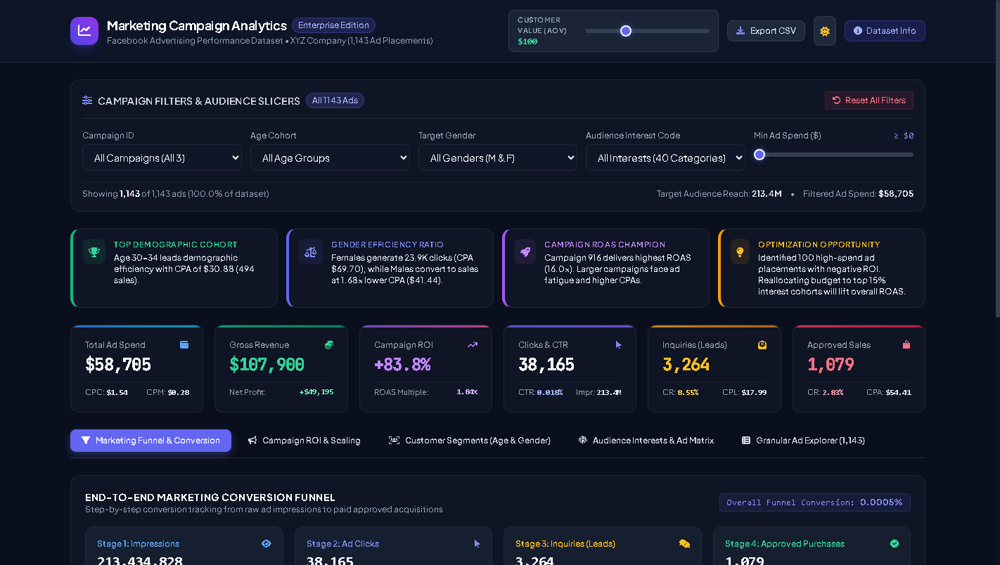

# 📊 Marketing Campaign Analytics Dashboard

> **Enterprise Marketing Performance & ROI Intelligence Dashboard**  
> Built with HTML5, Tailwind CSS, Vanilla JavaScript, and Chart.js. Fully responsive, zero backend required, and optimized for **GitHub Pages**.



---

## 🎯 Executive Overview

This interactive marketing analytics dashboard evaluates performance across **1,143 real-world Facebook advertising placements** conducted for XYZ Company. It tracks multi-tier marketing conversion metrics, audience demographic segmentation, and unit economics from top-of-funnel impressions down to bottom-of-funnel closed sales.

### 🌟 Key Capabilities
* **Interactive Audience & Campaign Slicers:** Filter instantly by Campaign ID, Age Cohort, Target Gender, Audience Interest Code, and Minimum Ad Spend.
* **Dynamic Sensitivity Modeling (AOV Slider):** Adjust target Customer Value / Average Order Value (AOV) from $10 to $300 to model real-time Gross Revenue, Net Profit, ROAS, and Campaign ROI.
* **4-Stage Marketing Conversion Funnel:** Tracks Impressions → Clicks → Inquiries (Leads) → Approved Purchases with drop-off rates and stage-by-stage conversion efficiency.
* **Demographic & Gender Paradox Discovery:** Visualizes why Female audiences drive high click volume while Male audiences yield superior purchase conversion rates at 1.68x lower CPA.
* **Automated Strategic Insights:** Generates real-time executive takeaways based on the currently filtered slice.
* **Granular Ad Records Explorer:** Searchable, sortable, paginated data table with instant CSV export.
* **Light & Dark Mode:** Native theme switcher with persistent local storage.

---

## 📁 Dataset Citation & Structure

* **Dataset Name:** Clicks Conversion Tracking (`KAG_conversion_data.csv`)
* **Source:** Kaggle / Public Facebook Advertising Dataset (XYZ Company)
* **Total Records:** 1,143 ad placements
* **Total Ad Spend:** $58,705.23
* **Total Impressions:** 213,434,828
* **Total Clicks:** 38,165
* **Total Approved Purchases:** 1,079

### Column Definitions

| Column | Data Type | Role in Dashboard | Description |
|---|---|---|---|
| `ad_id` | Integer | Table / Tooltip | Unique identifier for each individual ad unit |
| `xyz_campaign_id` | Integer / String | Slicer / Benchmark Chart | Ad campaign identifier (`916`: Pilot, `936`: Growth, `1178`: Scale) |
| `fb_campaign_id` | Integer | Table Explorer | Facebook Ads platform internal campaign tracker |
| `age` | Categorical | Slicer / Demographics Chart | Target age bracket (`30-34`, `35-39`, `40-44`, `45-49`) |
| `gender` | Categorical | Slicer / Segment Donut | Target gender audience (`M` = Male, `F` = Female) |
| `interest` | Integer | Slicer / Interest Matrix | Categorical topic interest identifier (40 unique segments) |
| `Impressions` | Integer | KPI / Funnel Chart | Number of times the ad was displayed on screen |
| `Clicks` | Integer | KPI / Funnel Chart | Number of clicks registered on the ad |
| `Spent` | Float | KPI / Cost / ROI | Amount billed by Facebook to company XYZ ($ USD) |
| `Total_Conversion` | Integer | KPI / Funnel Stage 3 | Inquiries or signups submitted following the ad exposure (Leads) |
| `Approved_Conversion` | Integer | KPI / Funnel Stage 4 | Verified paying customers who purchased the product (Sales) |

---

## 📐 Marketing Mathematical Formulas

All KPIs dynamically update based on active filters:

1. **Click-Through Rate (CTR):**  
   $$\text{CTR} = \left(\frac{\text{Clicks}}{\text{Impressions}}\right) \times 100\%$$
2. **Cost Per Click (CPC):**  
   $$\text{CPC} = \frac{\text{Ad Spend}}{\text{Clicks}}$$
3. **Cost Per Mille (CPM):**  
   $$\text{CPM} = \left(\frac{\text{Ad Spend}}{\text{Impressions}}\right) \times 1,000$$
4. **Lead Conversion Rate (Lead CR):**  
   $$\text{Lead CR} = \left(\frac{\text{Inquiries (Total\_Conversion)}}{\text{Clicks}}\right) \times 100\%$$
5. **Sales Conversion Rate (Sales CR):**  
   $$\text{Sales CR} = \left(\frac{\text{Approved Purchases}}{\text{Clicks}}\right) \times 100\%$$
6. **Customer Acquisition Cost (CPA):**  
   $$\text{CPA} = \frac{\text{Ad Spend}}{\text{Approved Purchases}}$$
7. **Gross Revenue:**  
   $$\text{Gross Revenue} = \text{Approved Purchases} \times \text{Customer Value (AOV)}$$
8. **Campaign Net Profit:**  
   $$\text{Net Profit} = \text{Gross Revenue} - \text{Ad Spend}$$
9. **Return on Ad Spend (ROAS):**  
   $$\text{ROAS} = \frac{\text{Gross Revenue}}{\text{Ad Spend}}$$
10. **Campaign Return on Investment (ROI %):**  
    $$\text{ROI} = \left(\frac{\text{Gross Revenue} - \text{Ad Spend}}{\text{Ad Spend}}\right) \times 100\%$$

> **Data Integrity Note:**  
> The original dataset records ad placements without row-level calendar timestamps. Campaign analysis and cohort analysis are structured across the 3 strategic campaign phases (`916`, `936`, `1178`) and demographic cohorts rather than arbitrary synthetic dates.

---

## 💡 Key Strategic Takeaways from the Data

1. **The Campaign Scaling Paradox:**
   - **Campaign 916 (Pilot):** Delivered **16.03x ROAS** with an ultra-efficient CPA of **$6.24**.
   - **Campaign 936 (Growth):** Achieved **6.32x ROAS** with a CPA of **$15.81**.
   - **Campaign 1178 (Scale):** Generated 80.8% of all sales (872 conversions) but suffered from ad fatigue, resulting in a **$63.83 CPA** and **1.57x ROAS**.
2. **Age Demographic Winner (Age 30–34):**
   - The 30–34 age cohort is the top performer, delivering 494 sales at an average CPA of **$30.88**.
   - The 45–49 cohort has the highest CTR (0.022%) but the worst conversion efficiency, resulting in a CPA of **$99.76**.
3. **The Gender Efficiency Disparity:**
   - Females generated **62.6% of clicks** (23,878 clicks, Spend: $34,502.62, CPA: $69.70).
   - Males generated fewer clicks (14,287) but produced **584 approved sales** at a CPA of **$41.44** (1.68x lower CPA than females).

---

## 🚀 How to Host on GitHub Pages (Step-by-Step)

This dashboard is a lightweight static web application that requires no build step.

### Step 1: Initialize Git Repository
In your terminal:
```bash
git init
git add .
git commit -m "Initial commit: Marketing Campaign Analytics Dashboard"
```

### Step 2: Push to GitHub
Create a new repository on [GitHub](https://github.com/new) named `marketing-campaign-analytics`, then:
```bash
git branch -M main
git remote add origin https://github.com/<YOUR-USERNAME>/marketing-campaign-analytics.git
git push -u origin main
```

### Step 3: Enable GitHub Pages
1. Go to your repository on GitHub.
2. Click **Settings** → **Pages** (under Code and automation in the left sidebar).
3. Under **Branch**, select `main` and root directory `/ (root)`.
4. Click **Save**.
5. Your dashboard will be live within 60 seconds at:  
   `https://<YOUR-USERNAME>.github.io/marketing-campaign-analytics/`

---

## 💻 Running Locally

To run locally using any lightweight static server:

```bash
# Using Python 3
python -m http.server 8080

# Or using Node.js npx
npx serve .
```
Then open `http://localhost:8080` in your web browser.

---

## 🛠️ Technology Stack
* **HTML5 Semantic Markup**
* **Tailwind CSS 3.4 (CDN)**
* **Vanilla JavaScript ES6+** (Zero frameworks, reactive state management)
* **Chart.js 4.4.2** (Responsive canvas data visualizations)
* **Font Awesome 6.5.1** (Vector icons)
